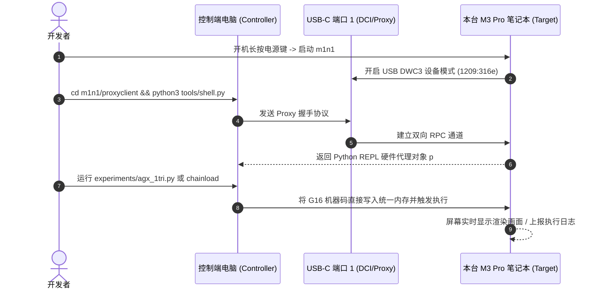

# Apple Silicon M3 Pro 双机 m1n1 远程调试与 GPU 实验完全指南

本指南指导如何使用**另一台电脑（控制端，Controller）**通过 USB-C 线缆远程控制**这台 MacBook Pro 14" M3 Pro (`Mac15,6`，目标端，Target)**，并在裸机（Bare-metal）与虚拟机监控器（Hypervisor）环境下直接调试 Apple G16 GPU。

---

## 🔌 一、硬件连线与物理接口拓扑

### 1. 目标机（MacBook Pro 14" M3 Pro `Mac15,6`）
MacBook Pro 14" 共有 3 个 Thunderbolt 4 (USB-C) 接口。Apple Silicon 的 SoC DCI (Direct Connect Interface) 和 m1n1 USB 设备控制器默认绑定在**左侧第一个 USB-C 接口**：

```text
  [屏幕转轴铰链]
  ┌──────────────────────────────────────────────┐
  │ [MagSafe 3]                                  │
  │ [⚡ USB-C 端口 1] <=== 【必须连接此端口！】   │
  │ [⚡ USB-C 端口 2]                            │
  │ [3.5mm 耳机孔]                               │
  └──────────────────────────────────────────────┘
```

> [!IMPORTANT]
> **必须使用全功能 USB 数据线（USB 3.1 / Thunderbolt 3/4 数据线）**。
> 纯充电线（只有 VBUS/GND 没有 D+/D- 或高速差分对）无法建立 proxy 连接。

### 2. 控制端电脑（Controller）
- 可以是任何运行 Linux、macOS 或 Windows (WSL2/USBIP) 的电脑。
- 将线缆另一端插入控制端电脑的任意可用 USB-C 或 USB-A（配合转接头）端口。

---

## 🖥 二、目标机（这台电脑）准备与启动

### 方式 A：如果本机已配置 Asahi Linux / m1n1 引导卷
1. 完全关机。
2. **长按电源键（Touch ID 按钮）**不放，直到屏幕出现：
   `"Loading startup options..."`（正在载入启动选项）。
3. 在启动项选择界面中，选择 **`m1n1` / `Asahi Linux`** 并点击“继续”。
4. 屏幕将点亮并显示 m1n1 图标或彩色测试条纹。
5. 此时，m1n1 的 USB Device Controller (DWC3) 已在端口 1 上就绪，静默等待控制端的命令！

### 方式 B：通过 macOS 1TR / kmutil 配置 m1n1
若需要更新或单独安装 m1n1 阶段一固件：
```bash
kmutil configure-boot -c m1n1.bin --raw --entry-point 2048 --lowest-virtual-address 0 -v /Volumes/<OS_VOLUME>
```

---

## 💻 三、控制端电脑（另一台电脑）配置

在控制端电脑上，完成以下三步即可直接控制本台电脑：

### 1. 克隆代码与安装依赖
```bash
# 克隆 m1n1 仓库（或从这台电脑同步）
git clone --recursive https://github.com/AsahiLinux/m1n1.git
cd m1n1/proxyclient

# 安装 Python 依赖
pip3 install construct pyserial pyusb
```

### 2. 检查 USB 连接与设备枚举
当连接到处于 m1n1 状态的目标机时：
* **Linux 控制端**：
  ```bash
  lsusb -d 1209:316e
  # 应看到类似：Bus 001 Device 015: ID 1209:316e Generic m1n1 proxy
  ls -l /dev/ttyACM*
  ```
* **macOS 控制端**：
  ```bash
  ioreg -p IOUSB | grep m1n1
  ls -l /dev/cu.usbmodem*
  ```

### 3. Linux 权限免 sudo 配置（udev 规则）
如果在 Linux 控制端遇到权限不足：
```bash
sudo cp ../udev/99-m1n1.rules /etc/udev/rules.d/
sudo udevadm control --reload-rules && sudo udevadm trigger
```

---

## 🎮 四、远程控制与 GPU 调试实战

在控制端的 `m1n1/proxyclient` 目录下，可直接运行以下强大的交互工具：

### 1. 进入交互式 Python 控制台 (`shell.py`)
```bash
python3 tools/shell.py
```
连接成功后，你将获得一个对 M3 Pro 硬件拥有最高特权（EL2/EL1）的 Python 终端 `p`：
```python
# 读取 M3 Pro 芯片 ID
print(hex(p.read32(0x280000000)))

# 查看设备树 (ADT - Apple Device Tree)
for k, v in p.adt["arm-io"].items():
    print(k)

# 探测 G16 GPU (SGX/AGX) 寄存器空间
gpu_base = p.adt["arm-io/sgx"].get_reg(0)[0]
print(f"G16 GPU MMIO Base: {hex(gpu_base)}")
```

### 2. 运行裸机 G16 GPU 渲染测试 (`agx_1tri.py`)
无需任何完整操作系统，直接通过 m1n1 在目标机屏幕上绘制由 G16 着色器驱动的三角形：
```bash
python3 experiments/agx_1tri.py
```
> 控制端会将编译好的顶点与片元着色器直接写入 M3 Pro 的统一内存（Unified Memory），配置 CDM/VDM 上下文，命令 G16 GPU 硬件管线执行渲染并在内置 Liquid Retina XDR 屏幕上显示！

### 3. 运行 Hypervisor 追踪 macOS 官方驱动 (`run_guest.py`)
m1n1 具备完整的第二阶段轻量级 Hypervisor：
```bash
python3 tools/run_guest.py
```
可以在虚拟化容器中启动原厂系统或 Linux 内核，实时拦截并打印 G16 GPU 的 MMIO 读写序列，这是逆向固件与微码的最强利器！

---

## 🔄 五、双机协作开发工作流


